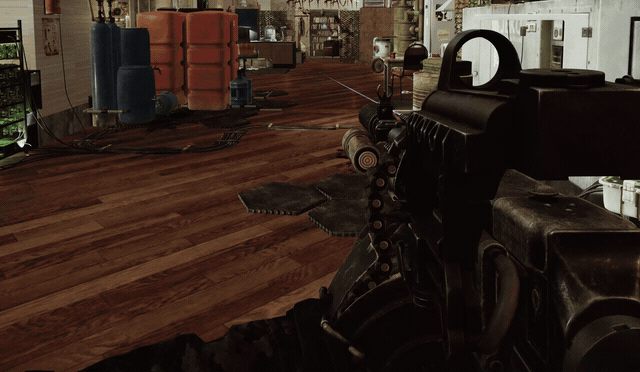
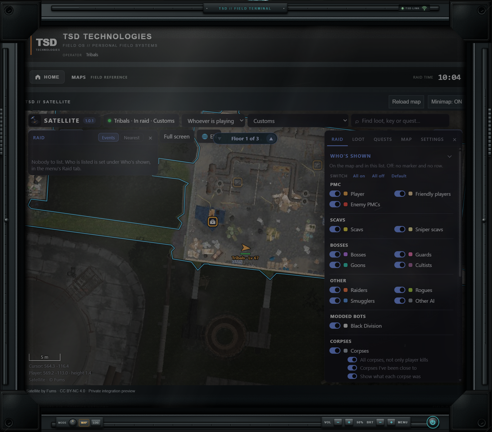
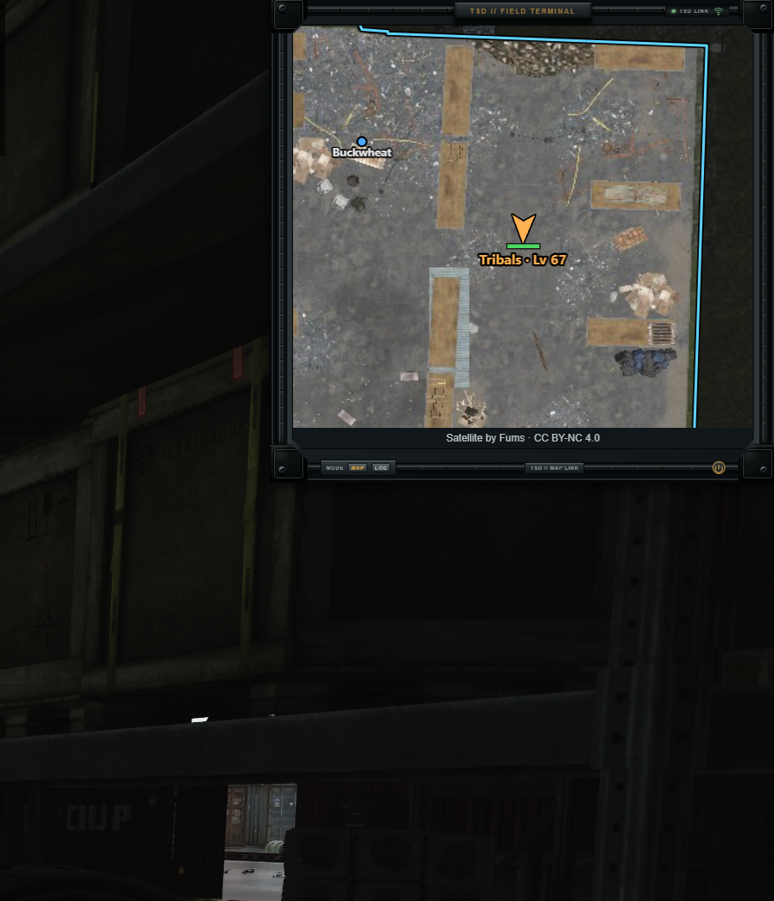

# TSD Technologies

**Your tools. One terminal.**

TSD Technologies brings a personal field tablet and its own **Field OS** to SPT. Customise your workspace, manage compatible apps, and take the device into a raid.

Purchase the **TSD Field Terminal from Mechanic at Loyalty Level 1**, with a base price of **₽75,000** before trader adjustments.

## Explore TSD Technologies {.tabset}

### Features

#### A physical Field Terminal

- Rectangular graphite tablet with slim corner plates and a matte black back.
- Matching inventory icon, inspection model and dropped tablet.
- Raise and put-away animations with equipment-handling sounds.
- Physical signal and activity indicators.
- Corrected collision so dropped terminals stay on the ground and can be picked up again.

#### Your personal workspace

- Home screen with app icons and a permanent **HOME** button.
- Personalised welcome and registered operator information.
- In-game time during raids and local computer time outside raids.
- Movable, resizable interface with saved window placement.
- Adjustable brightness, volume, interface sounds and accent colour.
- Built-in **TSD Signal** and **TSD Horizon** wallpapers.
- Support for custom PNG/JPG wallpapers, with previews and Fill/Fit options.
- Settings and device information displaying **Field OS 1.4.1**.
- **Unread badges** on Home-screen icons for compatible apps.
- App visibility tracking that distinguishes a visible app from a remembered page while the tablet is closed or on Home.

#### Less waiting between openings

The normal startup and welcome sequence now plays **once per game launch by default**. Open the tablet in the stash, then enter a raid without repeating the intro.

After the first completed startup, reopening the tablet resumes the latest page. Restarting the game resets the startup sequence. Cancelling it before completion does not count as a completed boot.

Prefer a fresh startup in each raid? Select **OncePerRaid** under **F12 → TSD Technologies → Tablet Startup → BootFrequency**.

#### Built-in apps

- **Settings:** customise the tablet, wallpapers, appearance and audio.
- **TSD Access:** scan for nearby keycard readers and run a timed bypass on a selected locked door. Scan range and bypass time are adjustable in F12.
- **App Browser:** browse compatible Field OS apps, read their details and open their Forge pages.
- **Maps:** access Satellite by Fums inside the tablet, with an optional matching tablet-framed minimap. **Satellite is a separate, optional installation.**

#### An expandable app platform

Compatible mods can register as separate apps inside Field OS. Apps are installed individually, so the tablet can be customised without requiring every available feature.

**[TSD Logistics](https://sp-mod.com/mod/3301/tactical-supply-drops)** provides stash cargo management, trader procurement and supply deliveries.

**[TSD Messenger](https://sp-mod.com/addon/196/tsd-messenger)** brings PMC conversations to the tablet, with contact portraits, unread badges and incoming-message notifications. Optional TrashTalk integration enables replies and conversations with recent PMC encounters.

Both apps are separate downloads. Neither is required to use the tablet’s built-in features.

### Messenger

**Keep PMC conversations on the Field Terminal.**

[TSD Messenger](https://sp-mod.com/addon/196/tsd-messenger) is a separate optional app for TSD Technologies. It brings the game’s PMC conversations into a dedicated tablet inbox.

- Latest conversations first, contact search and unread badges.
- Dedicated conversation view with a centred contact portrait and name.
- Outgoing message colours follow the tablet’s accent colour.
- Incoming-message notifications during raids and while the tablet is closed, with a double buzz, bell tone or silent option.
- With **TrashTalk installed and enabled**, reply to conversations or use **Compose** to contact recorded PMC encounters.
- Recorded fight details provide context for compatible TrashTalk replies.
- Conversation deletion with confirmation; deletion also removes the conversation from the normal game messenger.

Without TrashTalk, Messenger remains a **read-only conversation viewer**. TrashTalk supplies the replies using its own provider and delay settings. New contact portraits are generated outside raids to avoid interrupting combat; a silhouette appears until a portrait is available.

**Messenger 1.0.0 requires Technologies 1.3.0 or newer and works with this 1.4.1 release.** It is not bundled with the tablet.

[Get TSD Messenger on the Forge](https://sp-mod.com/addon/196/tsd-messenger)

The idea for Messenger came from using [Vultify’s TrashTalk](https://sp-mod.com/mod/2816/trash-talk) and wanting those conversations on the TSD tablet.

### Maps & Minimap

**Satellite’s live raid maps, inside the Field Terminal.**

The Maps app now connects to [Satellite by Fums](https://sp-mod.com/mod/3373/satellite). Satellite provides the maps, live raid information and map controls; TSD Technologies brings that interface into the tablet and adds an optional tablet-framed minimap.

#### Maps inside the tablet

- Drag to pan and scroll to zoom using Satellite’s map controls.
- Use Satellite’s menu to choose the information and markers to show or hide.
- Tablet map preferences are saved between game launches.
- **Hold M** by default to enlarge the minimap while continuing to move or sprint; release it to restore the usual size.
- Prefer a toggle? Select **Toggle** under **F12 → Satellite → MapExpansionMode**, then press M once to enlarge and again to restore.
- The enlarged view defaults to **85% of the screen** and **80% opacity**, with both adjustable in F12. The small minimap stays fully opaque.
- A short visual transition expands and collapses the existing map without reloading it.
- Rebind or disable the shortcut under **F12 → TSD Technologies → Controls → MapToggleKey**.

#### A minimap that belongs to the tablet

Enable **Minimap** from the Maps toolbar, then close the main tablet. During a raid, the compact map follows the player inside a matching graphite TSD casing.

- Click-through display keeps movement, aiming and normal gameplay available.
- Inherits the visibility choices set in the full tablet map.
- Size and screen position are adjustable under **F12 → TSD Technologies → Satellite**.
- Automatically hides while the main tablet is open and outside raids.
- Hold/Toggle enlargement works during normal gameplay without taking mouse or keyboard focus.
- Adjust **ExpandedMapSizePercent** and **ExpandedMapOpacity** under **F12 → Satellite**. Defaults are 85% size and 0.8 opacity.
- Map-image caching reduces repeat transfers when reopening the map; live raid information remains uncached.

The minimap and its enlarged view are click-through displays, not interactive control panels. Make map changes through the full Maps app. Its follow view and compact zoom are kept separate from the full map’s navigation.

#### Required for the Maps feature

Install **Satellite separately**, including its client, server and map files. This integration was tested with **Satellite 1.0.1**. Satellite remains optional for the rest of the tablet.

If Satellite is missing, Maps displays a requirement page with a button to its Forge listing. After installation, restart the game and SPT server. Existing Satellite files and normal external-browser settings are left untouched.

**Satellite by Fums, CC BY-NC 4.0.** The bridge adapts the viewer layout for the tablet and minimap. Satellite’s code and map pack are not bundled in the Technologies download.

[Get Satellite on the Forge](https://sp-mod.com/mod/3373/satellite) · [Satellite source](https://github.com/MrFums/Satellite) · [Licence](https://creativecommons.org/licenses/by-nc/4.0/)

### How It Works

1. Purchase the TSD Field Terminal from Mechanic.
2. Carry it in your PMC inventory to use it during a raid.
3. Press your configured tablet key. Fresh installations default to **F9**; existing key settings are preserved.
4. The character raises the tablet before Field OS opens.
5. Select an app or resume the page last used.
6. Use the power button or tablet key to close the interface and put the device away.

For the interactive map, open the tablet normally and select **Maps**. **M** controls minimap enlargement only and does not raise the tablet. The normal tablet key still resumes the latest page.

Pressing the tablet key again during the raise cancels the opening sequence.

Stop sprinting, aiming or performing another hands interaction before opening the tablet. Movement stops while the interactive overlay is open.

#### Positioning the interface

The interface currently opens as a **separate movable overlay**. Resize and position it over the physical tablet’s screen to suit your view.

The overlay does not follow the tablet’s movement. Direct integration into the physical screen remains a future development goal.

Animation and handling-sound controls are available in the main **TSD Technologies F12 configuration**. Animation can be disabled for interface-only access.

### Installation & Requirements

#### Requirements

- **SPT 4.1.6**
- **Anvil WebOverlay 1.12.0 or newer**
- **Optional: Satellite 1.0.1**, installed separately for Maps and the minimap.
- Compatible tablet apps installed separately, if desired.

**Fika compatibility remains unverified.** Individual apps may have additional requirements or compatibility limitations.

#### New installation

1. Close the game and SPT server.
2. Install Anvil WebOverlay according to its instructions.
3. Download **TSD Technologies 1.4.1**.
4. Extract the ZIP into the main SPT game folder beside `EscapeFromTarkov.exe`, merging its `BepInEx` and `SPT_Runtime` folders.
5. Start the server, then launch the game.

**Do not extract only into `SPT_Runtime`.** Both client and server files must remain in their included locations.

#### Updating an existing Technologies installation

1. Close the game and server.
2. Back up the player profile and tablet settings.
3. Extract the **1.4.1** ZIP into the main SPT game folder.
4. Merge the included folders and replace existing Technologies program files.
5. Keep existing configuration, custom wallpapers and separately installed apps.

**No settings reset is required.**

**TSD Logistics 3.1.0 remains compatible and does not need updating.** Leave it installed. Do not combine Technologies with standalone Tactical Supply Drops 2.1.0.

**TSD Messenger 1.0.0 requires Technologies 1.3.0** and is installed separately.

[Download Technologies 1.4.1](https://github.com/NomadTribals/TSD-Technologies/releases/download/v1.4.1/TsdTechnologies-1.4.1.zip) · [Full upgrade guide](https://github.com/NomadTribals/TSD-Technologies/blob/v1.4.1/docs/Upgrade-TsdTechnologies.md)

### For App Developers

TSD Technologies provides a shared tablet interface for creators who want their mods to run as Field OS apps.

The app API supports registration, custom app icons, app content and communication between the interface and the mod. Compatible apps appear on the Home screen alongside other installed apps.

Technologies **1.3.0** adds:

- **Home-screen badges:** display an unread count or clear it when appropriate.
- **App visibility reporting:** distinguish an app that is actually visible from a remembered page while the tablet is closed or showing Home.

The **API assembly remains at 1.0.0** for compatibility. Apps using the new badge and visibility features should require **TSD Technologies 1.3.0 or newer**.

[App API and developer instructions](https://github.com/NomadTribals/TSD-Technologies/tree/v1.3.0/TsdTechnologies.Api)

### Future Development

Areas planned for exploration include:

- **Physical screen integration:** displaying the live interface directly on the held tablet so it follows the device’s movement.
- **Maps integration:** refining the Satellite tablet and minimap experience as compatibility and testing allow.
- **More personalisation:** additional wallpapers, device sounds and appearance options.
- **Community apps:** expanding what creators can build for the tablet.

These are development goals, not guaranteed features or release dates. Performance, compatibility and permissions will guide implementation.

### Credits & Support

**Special thanks to maschine, author of Anvil WebOverlay.**

The tablet interface would not have been possible without that framework. Thank you for the direct support, testing and improvements made with this project in mind.

[Anvil WebOverlay](https://github.com/maschine34675/WebOverlay)

**Thanks to Fums for Satellite.** Its live map system makes the tablet Maps app and minimap possible. Satellite by Fums, CC BY-NC 4.0; the bridge adapts its viewer presentation and installs separately.

[Satellite on the Forge](https://sp-mod.com/mod/3373/satellite) · [Satellite source and licence](https://github.com/MrFums/Satellite)

Thanks to **Vultify** for TrashTalk, the inspiration and optional reply provider for TSD Messenger.

Found a problem? Include the installed versions, steps to reproduce it, relevant logs and screenshots where possible.

[Source code and issue tracker](https://github.com/NomadTribals/TSD-Technologies)